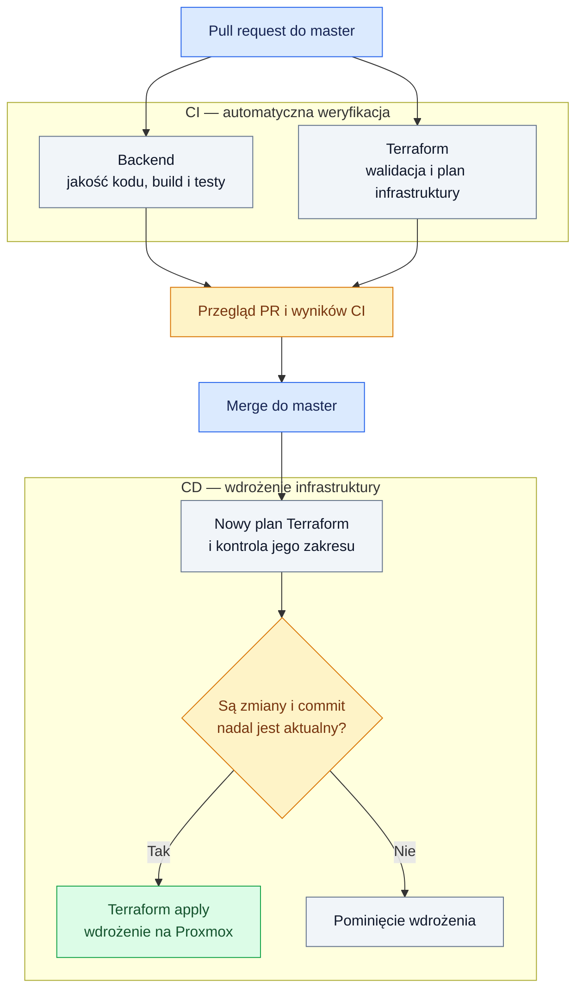

# CI/CD projektu 4Money

Diagram odzwierciedla konfigurację repozytorium sprawdzoną 20 października 2026 r.
CI sprawdza backend i plan infrastruktury. CD wdraża infrastrukturę Proxmox.
W obecnych workflow nie ma publikowania ani wdrażania aplikacji backendowej.

Źródło do edycji: [ci-cd.mmd](ci-cd.mmd). Poniższy blok można edytować także
bezpośrednio w Markdown. Linie ciągłe pokazują przepływ wykonania, a przerywane
przekazanie wyników do przeglądu lub korzystanie ze wspólnego stanu.

## Jak czytać diagram

- **CI:** po otwarciu, ponownym otwarciu lub aktualizacji PR do `master`
  uruchamiają się niezależne workflow `Backend CI` i `Terraform Plan`.
  PR z forka pomija te joby. Nie ma filtrów ścieżek plików.
- **Przegląd i merge:** strzałki do przeglądu oznaczają pracę zespołu,
  a nie automatyczny merge. README infrastruktury opisuje wymaganą akceptację
  PR i check `Terraform checks and plan`; ustawienia ochrony gałęzi na GitHub
  nie były weryfikowane w ramach tego zadania.
- **CD:** każdy push do `master`, w tym merge, uruchamia `Terraform Deploy`.
  Workflow tworzy nowy plan dla dokładnego SHA — nie wykorzystuje planu z PR.
  Wdrożenie nie czeka na workflow backendu i nie ma drugiego zatwierdzenia.
- **Warunki apply:** plan musi przejść kontrolę zakresu, zawierać zmiany,
  a wdrażany commit musi nadal być HEAD `master`. Brak zmian lub nowszy commit
  pomija apply. Błąd walidacji, planowania albo odczytu HEAD zatrzymuje wdrożenie.
- **Wykonanie:** wszystkie joby używają runnera `self-hosted, Linux, X64`;
  README wskazuje `dell-runner` na VM 205. Joby backendowe działają w kontenerach
  uv/Python i .NET 10, a Terraform wykonuje się na runnerze.
- **Stan:** HCP Terraform przechowuje i blokuje wspólny stan; workspace działa
  w trybie Local. Połączenie z API Proxmox realizuje Terraform na runnerze.
  Wdrożenia są serializowane bez automatycznego anulowania aktywnego apply.
- **Uruchomienie ręczne:** każdy z trzech workflow obsługuje `workflow_dispatch`.
  Terraform Deploy dopuszcza wyłącznie `master`. Dla czytelności diagram
  pokazuje główną ścieżkę PR → merge → deployment.

## Ograniczenia i obsługa błędów

- Jeśli backend nie występuje w śledzonych plikach, jego kontrole są pomijane;
  obecność kodu bez wymaganej solucji kończy wykrywanie błędem.
- Testy w CI obejmują tylko projekty z końcówkami `.UnitTests.csproj`
  i `.IntegrationTests.csproj`. Projekt `ZPI4M.Banking.Tests.csproj` jest pomijany.
  Brak pasujących projektów daje komunikat `not configured`, a nie wykonane testy.
- Testy jednostkowe, a następnie integracyjne są podejmowane po udanym buildzie
  także przy błędzie formatowania lub wcześniejszych testów, o ile job nie został
  anulowany. Podsumowanie i upload dostępnych TRX są podejmowane także po błędzie.
- Terraform dopuszcza tworzenie, aktualizację, usuwanie i zastępowanie VM
  w zakresie 250–255 na `dell`. Konfiguracja deklaruje obecnie tylko VM 250,
  tworzoną jako zatrzymaną. Kontrola zakresu nie oznacza zakazu usuwania.
- Plany są tymczasowe i nie są publikowane jako artefakty. Sprzątanie ma warunek
  `always()`. Błąd apply nie uruchamia automatycznego rollbacku.
