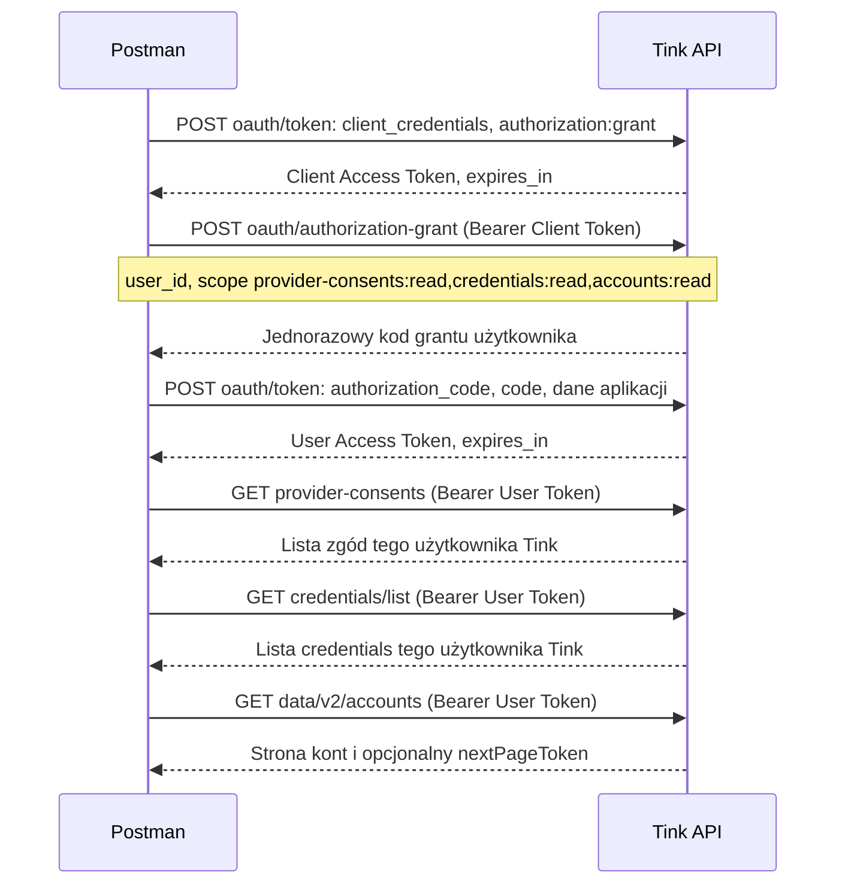
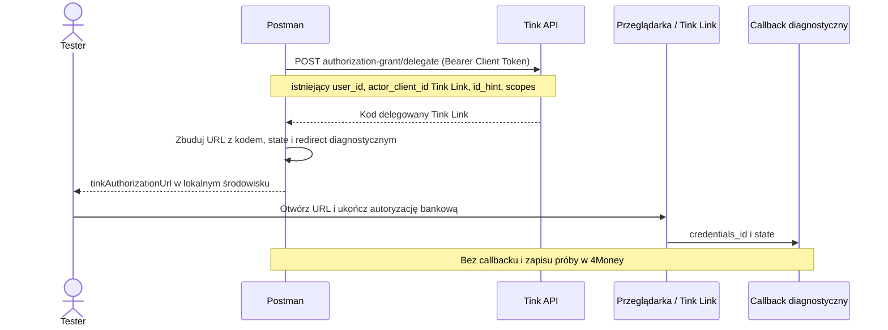

# Postman: testowanie flow Tink w 4Money

Kolekcje znajdują się w [postman/](../postman/). Weryfikują wyłącznie integrację
Tink: połączenie banku, tokeny potrzebne do operacji oraz odczyt zgód,
credentials, kont i transakcji wskazanego konta. Nie testują
pozostałych funkcji User. Kolekcja Banking zawiera
krok logowania 4Money przygotowujący token do dalszego flow.

## Dwie niezależne ścieżki

| Kolekcja | Co sprawdza | Czego nie potwierdza |
| --- | --- | --- |
| `4Money.Banking` | Publiczny kontrakt backendu i zapisany rezultat łączenia banku | Same poprawne odpowiedzi nie zastępują ręcznego logowania do banku |
| `Tink.Diagnostics` | Bezpośrednie wywołania Tink dla istniejącego użytkownika Sandbox | Nie zapisuje próby ani połączenia w bazie 4Money, nie sprawdza callbacku backendu |

Kolekcje i środowiska importujemy z plików JSON. Podczas używania każdej kolekcji
wybieramy odpowiadające jej środowisko. Wymagany jest aktualny Postman Desktop
z obsługą `pm.execution.skipRequest()`, `pm.execution.setNextRequest()` oraz `URL`.
Nie dodajemy obecnie Newman do CI.

## Przygotowanie środowisk

### API 4Money

Importuj `4Money.Local.example.postman_environment.json` i utwórz własne lokalne
środowisko. Domyślny `baseUrl` to `http://localhost:5283`, bez końcowego ukośnika.
To adres backendu w Compose oraz domyślnego profilu `http` przy `dotnet run`.
W już zaimportowanym środowisku ustaw ten adres ręcznie; zmiana pliku w repo
nie aktualizuje istniejącego środowiska w Postmanie.
Uruchamiaj backend profilem `https` z katalogu projektu API. Zapewnij zaufanie
Postmana do lokalnego certyfikatu HTTPS.

Wymagania bazy i migracji opisuje [instrukcja pracy](../agent-context/development.md).
Wymagane ustawienia aplikacji Tink, dopuszczony rynek, zakres uprawnień i callback
opisuje [notes/TINK.md](TINK.md). Backendowy `Tink__RedirectUri` musi prowadzić
do `/api/banking/tink/callback`. `ContinuousAccessVerified` ustawiamy dopiero po
potwierdzeniu dostępu aplikacji do produktu i uprawnień w Tink Console.

Host 4Money implementuje logowanie i walidację JWT w module User. Żądanie
**10 — Zaloguj użytkownika 4Money** w kolekcji Banking zapisuje `accessToken`
jako `fourMoneyAccessToken` w wybranym środowisku. Można także użyć osobnej kolekcji User. Konto musi być aktywne, a sesja aktualna. Brak ważnego tokenu daje 401.
Adapter Banking odczytuje lokalny GUID z `sub` zweryfikowanej tożsamości;
obsługuje również `ClaimTypes.NameIdentifier`. Middleware uwierzytelniania działa
przed autoryzacją. Nie dodajemy nagłówków z tożsamością ani tokenów generowanych
przez skrypt Postmana. Instrukcję User opisuje [postman/README.md](../postman/README.md).

### Bezpośrednia diagnostyka Tink

Importuj `Tink.Sandbox.example.postman_environment.json`. Lokalnie uzupełnij:

- `tinkClientId` i `tinkClientSecret` aplikacji Sandbox.
- `tinkUserId` istniejącego użytkownika należącego do tej samej aplikacji.
- `tinkIdHint` — syntetyczną nazwę użytkownika testowego, potrzebną do Tink Link.
- `tinkDiagnosticRedirectUri` — osobny adres dopuszczony w Tink Console;
  domyślnie `https://console.tink.com/callback`, jeśli jest zarejestrowany.

`ActorClientId` Tink Link jest odrębny od naszego Client ID. Szablon zawiera
wartość aktora, rynek PL, locale en_US oraz scope’y i refreshable items używane
przez adapter projektu. Ich dostępność dla aplikacji nadal wymaga potwierdzenia.
Grant diagnostyczny wymaga `provider-consents:read`, `credentials:read` oraz
`accounts:read`; wszystkie muszą być dostępne w aplikacji Tink Console. Token
aplikacyjny w kolekcji żąda `authorization:grant`. Scope’y odczytów odpowiadają
[referencji Tink](https://docs.tink.com/api/statistics).

Diagnostyczny link nie może wracać do callbacku 4Money. Bez lokalnej próby
backend nie ma skrótu state, z którym mógłby skorelować powrót. Skrypt blokuje
użycie ścieżki backendowego callbacku w tym scenariuszu.

## Pełny flow przez backend

Uruchamiamy po konfiguracji JWT/bazy, przygotowaniu aktywnego konta z potwierdzonym
e-mailem oraz aplikacji Tink. Konto z lokalnego seedera nie wymaga rejestracji/SMTP.

1. Wybierz środowisko 4Money i ustaw `baseUrl`, `userLogin` i `userPassword`.
2. Uruchom folder **10 — Rozpoczęcie połączenia**. Żądanie 10 loguje użytkownika
   (200), zapisuje wyłącznie `accessToken` jako `fourMoneyAccessToken` i przechodzi
   bezpośrednio do żądania 11 rozpoczynającego połączenie (HTTP 201).
   Backend sam tworzy lub odzyskuje brakującego użytkownika Tink. Po 503 ponów
   żądanie 11 w tej samej sesji; nie rejestruj konta ponownie. Każde ponowienie
   tworzy nową próbę, ale wykorzystuje istniejące lub odzyskane mapowanie Tink.
   Skrypt zapisze `attemptId`, `attemptExpiresAt`, `authorizationUrl` i
   `callbackState`, po wcześniejszym usunięciu danych starej próby.
3. Następne żądanie sprawdza stan `PENDING`. Runner zatrzymuje się po nim.
   To koniec pierwszego etapu, a nie całego testu.
4. Otwórz lokalną wartość `authorizationUrl` w przeglądarce. Nie wysyłaj jej
   jako zwykłego GET w Postmanie: interaktywny wybór banku i autoryzacja wymagają
   przeglądarki. Wybierz Demo Bank, użyj jego danych testowych i ukończ proces.
5. Przeglądarka wróci do callbacku backendu. Sukces zwraca JSON próby z
   `COMPLETED` i lokalnym `connectionId`. To ten callback kończy proces;
   nie wywołujemy go jeszcze raz w zwykłej ścieżce sukcesu.
6. Uruchom folder **20 — Po powrocie z banku**. Pierwsze żądanie wymaga
   `COMPLETED` i zapisuje `connectionId`. Kolejne sprawdzają połączenie
   `CONNECTED`, synchronizację `NOT_STARTED` i obecność na liście połączeń.
   Lista może zawierać więcej banków.
7. Osobno uruchom folder **30 — Zgody**. Sprawdza bieżącą odpowiedź 4Money:
   lokalne `connectionId`, niepusty `providerStatus`, nullable `sessionExpiresAt`
   i `sessionExtendable`. Pusta tablica jest dopuszczalna. Nie zakładamy,
   że każda zgoda ma status UPDATED ani że brak zgody oznacza jej cofnięcie.

Po nieudanym kroku kolejność jest zatrzymywana. Nie przechodzimy dalej z danymi
poprzedniej udanej próby. Przed otwarciem linku nie powtarzaj POST bez potrzeby:
każde wywołanie tworzy nową trwałą próbę.

```mermaid
sequenceDiagram
    actor Tester
    participant P as Postman
    participant API as API 4Money
    participant DB as Baza 4Money
    participant T as Tink API
    participant B as Przeglądarka / Tink Link
    Tester->>P: Token JWT z logowania 4Money
    P->>API: POST connection-attempts (Bearer 4Money)
    API->>API: Zweryfikowana tożsamość i lokalny User ID
    API->>DB: Odczyt profilu i zapis próby PENDING ze skrótem state
    opt Brak zapisanego TinkUserId
        API->>T: Client token user:create, utworzenie / odzyskanie użytkownika
        API->>DB: Zapis TinkUserId
    end
    API->>T: Client token authorization:grant i delegated authorization
    API-->>P: 201: attemptId, authorizationUrl, expiresAt
    P->>API: GET connection-attempts/{attemptId}
    API-->>P: PENDING
    Note over P,B: Runner zatrzymany; dalszy krok ręczny
    Tester->>B: Otwórz authorizationUrl, wybierz bank i autoryzuj
    B->>API: GET callback: state, credentials_id
    API->>T: User token credentials:read, weryfikacja credentials
    API->>DB: Atomowy zapis połączenia i COMPLETED
    API-->>B: JSON zakończonej próby
    Tester->>P: Uruchom folder 20, następnie 30
    P->>API: Odczyt próby, połączenia i zgód
    API-->>P: Lokalne połączenie / aktualne zgody
```

### Callback chwilowo niedostępny

Dla 503 z `Retry-After: 5` backend pozostawia próbę do ponowienia, jeśli problem
jest przejściowy. Przeglądarka nie ponawia automatycznie żądania na podstawie
samego nagłówka. Można ręcznie ponowić ten sam callback po odczekaniu, przed
wygaśnięciem próby. Nie wprowadzamy nieograniczonej pętli ani traktowania 503
jako sukcesu. Domyślne 15 minut dotyczy próby; nie obiecuje ważności kodu Tink.
Po wygaśnięciu trzeba rozpocząć nową próbę.

### Błędy flow Tink

Folder **90** uruchamiamy osobno, nie jako dalszy ciąg nieukończonej próby.

- Żądanie **91** używa syntetycznie niepoprawnego state i credentials_id.
  Oczekuje 400 z `BANKING_INVALID_CALLBACK` i `no-store`. Nie wymaga tokenu 4Money.
- Żądanie **92** wymaga udanego folderu 20 i lokalnej wartości
  `callbackCredentialsId`, odczytanej z adresu callbacku w przeglądarce.
  Korzysta ze state już zapisanej próby, nie wysyła Bearer tokenu i oczekuje 409
  `BANKING_CONFLICT` dla tej samej próby. To test ponowienia zakończonego flow.

Jeżeli brakuje wymaganych wartości, skrypt oznacza warunki wstępne jako błędne
i nie wysyła żądania. Nie traktuj pominięcia ani zatrzymania runa jako zaliczenia
całej kolekcji. Krok logowania służy przygotowaniu Bearera; nie zastępuje testów
pełnego modułu User. Nie ma tu odczytów profilu ani testów innych modułów.

## Diagnostyka tokenu, zgód, credentials i kont bez gotowego auth 4Money

1. Wybierz środowisko Tink Sandbox.
2. Uruchom folder **10 — Token aplikacji**. Wywołuje `/oauth/token` ze scope’em
   `authorization:grant`. Czyści stare tokeny i kody diagnostyczne.
3. Uruchom cały folder **20 — Token użytkownika i odczyty diagnostyczne**.
   Tworzy grant dla `tinkUserId` ze scope’ami
   `provider-consents:read,credentials:read,accounts:read`, wymienia jego
   jednorazowy kod i wykonuje trzy odczyty:
   **23** — `GET /api/v1/provider-consents`,
   **24** — `GET /api/v1/credentials/list`,
   **25** — `GET /data/v2/accounts?pageSize=100`.
4. Sprawdź wyniki testów i odpowiedź Tink. Pusta lista może być prawidłowa.
   Skrypty zachowują rozdział tokenu aplikacyjnego i tokenu użytkownika.

Krok 25 pobiera jedną stronę kont. Jeśli odpowiedź zawiera niepusty
`nextPageToken`, skopiuj go do lokalnej zmiennej `tinkAccountsPageToken`, włącz
parametr `pageToken` w zakładce Params i ponów krok 25. Powtarzaj do braku
niepustego `nextPageToken`. Przed nowym pełnym runem wyłącz ten parametr,
aby zacząć od pierwszej strony. Nie zapisuj tokenów stron ani odpowiedzi
z danymi rachunków w repozytorium.

Porównaj `id` z credentials z `credentialsId` w provider-consents oraz
`accountIds` zgody z `id` kont. Skrypty dopuszczają puste listy i sprawdzają
kontrakt każdej odpowiedzi; nie wymagają zgodności list między kolejnymi
wywołaniami. Diagnostyka nie importuje danych do 4Money i nie wykonuje refreshu.
Po rozszerzeniu kolekcji ponów kroki 21–22: wcześniejszy token odczytu zgód
nie ma dodatkowych scope’ów. Nazwy zmiennych `tinkConsentCode`,
`tinkConsentAccessToken` i `tinkConsentTokenExpiresAt` pozostają zgodne
z poprzednim środowiskiem; teraz obsługują wszystkie trzy odczyty.

Tokeny i ich terminy są zapisywane jedynie w lokalnym środowisku Postmana na
potrzeby kolejnych żądań testowych. Nie jest to zmiana strategii cache backendu.
Skrypt uwzględnia `expires_in` z marginesem czasu. Gdy token wygasł, wróć do
odpowiedniego folderu: 10 dla Client Access Tokenu albo pełnego 20 dla User
Access Tokenu. Po błędzie wymiany kodu nie powtarzaj starego kodu — uzyskaj nowy.
Grant diagnostyczny nie używa `/delegate` ani `refresh_token`.



## Transakcje wskazanego konta i uprawnienia

Folder **40 — Transakcje wskazanego konta** uruchamiaj osobno:

1. Uruchom folder **10**, jeśli token aplikacyjny wygasł. Ten krok czyści też
   token transakcji, więc wykonuj go przed pozostałymi folderami.
2. Ustaw `tinkUserId` na właściciela rachunku. W kroku **25** znajdź konto
   i skopiuj jego `id` do lokalnego `tinkAccountId`. To identyfikator Tink,
   nie `externalAccountId`, numer rachunku ani lokalne ID 4Money.
3. Uruchom cały folder **40**. **41** tworzy grant tylko z `transactions:read`,
   **42** wymienia kod na osobny token, **43** wykonuje
   `GET /data/v2/transactions?accountIdIn={{tinkAccountId}}&pageSize=100`.
   Nie trzeba zmieniać scope’ów Tink Link ani tokenu z folderu 20.
4. Testy wymagają HTTP 200, listy `transactions`, identyfikatorów, statusu,
   kwoty w reprezentacji `currencyCode` i `value` (`unscaledValue`, `scale`)
   oraz `accountId` zgodnego z wybranym kontem. Nie przeliczają pieniędzy
   przez zmiennoprzecinkowy `Number`. Odpowiedź pozostaje lokalnie w Postmanie.
5. Jeśli jest niepusty `nextPageToken`, skopiuj go do
   `tinkTransactionsPageToken`, włącz parametr `pageToken` w Params kroku 43
   i ponów ten krok. Kontynuuj do braku tokenu kolejnej strony. Wyłącz
   `pageToken` przed zmianą konta, użytkownika lub nowym pełnym runem.

Po wygaśnięciu tokenu lub zmianie `tinkUserId` ponów **41–42**. Zmienne
`tinkTransactionsCode`, `tinkTransactionsAccessToken`,
`tinkTransactionsTokenExpiresAt` i `tinkTransactionsTokenUserId` są oddzielone
od tokenu zgód i kont. Kod jest jednorazowy; po błędzie wymiany wróć do 41.

Dla danych syntetycznych z Connector użyj użytkownika, na którego wykonano
seed, oraz Tink `id` rachunku widocznego w 25 (również mapowanego w lokalnym
manifeście CLI). Jeśli pracujesz z `externalUserId`, nie wpisuj go w
`tinkUserId`: ten flow używa grantu z `user_id`, czyli wewnętrznym ID Tink.
CLI uzyskuje swój grant przez `external_user_id`. Przetworzenie operacji
Connector musi być zakończone, zanim odczyt potwierdzi obecność transakcji.
Pusta lista jest poprawną odpowiedzią API, ale nie dowodzi poprawnego ingestu.
Porównaj zwrócone kwoty, waluty i opisy z syntetycznym presetem, a `reference`
z `externalTransactionId` w manifeście. Ten odczyt nie wymaga tworzenia
bankowego credential ani zgody provider-consent dla syntetycznego konta.

Scope `transactions:read` jest przypisany do `/data/v2/transactions` w
[referencji Tink](https://docs.tink.com/api/statistics). Uprawnienie aplikacji
w Console i scope faktycznie uzyskanego tokenu to osobne warunki dostępu;
`accounts:read` ani `transactions:write` nie zastępują `transactions:read`.
Jeśli 41 lub 42 kończy się błędem, sprawdź przyznane aplikacji scope’y
zanim przejdziesz do odczytu.

Folder **90 — Uprawnienia odczytu transakcji (osobno)** zawiera:

- **91** — odczyt tym samym filtrem, z ważnym tokenem z pełnego folderu **20**,
  bez `transactions:read`. Oczekuje dokładnie **403**. Pozytywne 200 oznacza
  niezaliczony test izolacji scope’ów; 401 wymaga odnowienia tokenu z 20.
- **92** — odczyt bez nagłówka Authorization. Oczekuje dokładnie **401**,
  nie wymaga tokenów z 20 ani 40.

Do porównania używaj tego samego konta i użytkownika: najpierw potwierdź
odczyt w 43, potem uruchom folder 90. Testy te sprawdzają brak scope’u i brak
uwierzytelnienia; nie sprawdzają izolacji między dwoma użytkownikami.
Brak danych lub niepoprawne ID nie są dowodem odmowy dostępu do cudzego konta.
Wynik ręcznego runu potwierdzi dostęp dla konkretnej aplikacji Sandbox;
walidacja lokalna kolekcji sama nie potwierdza uprawnień produktu ani danych.

## Osobne delegowanie Tink Link

Po folderze diagnostycznym 10 uruchom folder **30 — Tink Link**. Wywołuje
`/oauth/authorization-grant/delegate` i buduje poprawnie kodowany URL dla
istniejącego `tinkUserId`. Zapisuje osobne `tinkDelegatedCode`,
`tinkDiagnosticState` oraz `tinkAuthorizationUrl`; nie używa tokenu odczytu zgód.

Otwórz `tinkAuthorizationUrl` w przeglądarce. Redirect prowadzi do strony
konsoli albo innego dopuszczonego adresu diagnostycznego. State jest tu jedynie
wartością korelacyjną do porównania przy ręcznym teście; nie ma za nim lokalnej
próby ani ochrony callbacku backendu. Po tym teście można ponownie pobrać zgody
w folderze 20. Połączenie utworzone tą drogą nie pojawi się automatycznie
w bazie 4Money; jego zgoda może być widoczna tylko w diagnostyce Tink.



## Refresh danych przez backend 4Money

Folder **40 — Refresh on demand (automatyczny)** wykonuje logowanie, zlecenie
zadania, ograniczony polling oraz walidację wyniku. Uruchamiaj go w Collection
Runnerze z jedną iteracją i **Delay=2000 ms**. Pojedynczy Send nie uruchamia pętli.
Domyślnie oczekuje SUCCEEDED i przynajmniej jednego konta; konfiguracja:
`bankRefreshExpectedStatus`, `bankRefreshMinAccounts`,
`bankRefreshTimeoutSeconds=2400`, `bankRefreshMaxPolls=1200`.
202 oznacza przyjęcie zadania, a timeout testu nie nadaje zadaniu statusu FAILED.

Folder **50** sprawdza ponowną synchronizację na niezmienionych danych.
**60** testuje 401/404/409 z osobnymi tokenami innych użytkowników.
**70–74** obejmują kontrolowane błędy, pustą listę i duplikację aktywnego zadania
przez lokalną atrapę Tink. **75/76** przygotowują i sprawdzają wznowienie po
rzeczywistym przerwaniu procesu. Scenariusze wymagające fixture uruchamiaj osobno;
nie włączaj ich do runu rzeczywistego Sandboxu.

Pełne komendy, TLS, testy SQL i ograniczenia są w
[instrukcji lokalnej symulacji](../postman/simulations/banking-refresh/README.md).
[Zapytania SQL](../postman/support/refresh-verify.sql) są tylko do odczytu.
Kolekcja sprawdza wyniki i liczniki zadania; potwierdzenie zawartości tabel
pozostaje oddzielnym krokiem. Nie dodano endpointów odczytu ani zmian backendu.

## Sekrety i eksporty

Śledzone szablony zawierają puste wartości tokenów, kodów, Client Secret i danych
użytkownika. Uzupełniaj je jako wartości lokalne w Postmanie. Oznaczenie pola jako
`secret` maskuje widok, ale samo w sobie nie zabezpiecza udostępnionego eksportu.
Nie udostępniaj wartości przez synchronizację zespołową ani wyników runa z danymi
poufnymi. Nie dodawaj odpowiedzi z tokenami do zakładki Examples.

Lokalne eksporty zapisuj jako `*.local.postman_environment.json`; wyniki do
`postman/results/`. Oba wzorce są ignorowane przez Git. Pozostałe eksporty
przejrzyj przed commitem. Pełne Link URL-e zawierają kod autoryzacyjny, a adresy
callbacku state i credentials_id. Nie publikuj ich w zgłoszeniach, logach ani
zrzutach. Skrypty kolekcji nie używają `console.log`.

## Jak zespół powinien rozbudowywać kolekcje

- Zachowuj podział: publiczne API 4Money oraz osobna diagnostyka dostawcy.
  Nowe testy mają dotyczyć Tink; nie dokładaj testów innych modułów do tych kolekcji.
- Używaj ponumerowanych folderów i opisuj warunki wstępne każdego kroku.
  Nie dodawaj domyślnie wywołań tworzących użytkowników, odświeżających dane lub
  przedłużających zgody bez uzgodnionego zakresu.
- Używaj zmiennych, formularzy urlencoded i bezpiecznego kodowania URL.
  Nie łącz tokenu logowania 4Money, Client Access Tokenu, User Access Tokenu
  i kodu delegowanego w jedną zmienną.
- Zapisuj zmienne dopiero po sprawdzeniu statusu i kontraktu. Czyść stare wyniki
  przed nowym flow. Błędy warunków wstępnych mają zatrzymać wykonanie i być widoczne.
- Sprawdzaj konkretne statusy; nie akceptuj alternatywy „200 albo 503”. Brak
  danych może być sukcesem tylko tam, gdzie kontrakt dopuszcza pustą listę.
- Nie automatyzuj interaktywnego logowania bankowego i nie wywołuj poprawnego
  callbacku drugi raz w happy path. Powtórzenie testuj jako osobny scenariusz 409.
- Przy zmianie DTO lub endpointu aktualizuj odpowiednią kolekcję, opis i tę notatkę.
  Po zmianach zweryfikuj schemat JSON, składnię i działanie skryptów na danych
  syntetycznych, a następnie uruchom pre-commit dla zmienionych plików.

## Co oznacza weryfikacja kolekcji

Walidacja formatu i skryptów nie potwierdza uprawnień aplikacji Tink, działania
banku, wdrożenia migracji ani auth 4Money. Run zatrzymany przed przeglądarką nie
jest pełnym E2E. Rzeczywisty sukces raportuj dopiero po przejściu całego procesu
w Sandboxie i sprawdzeniu zapisanej próby/połączenia. Odczyt zgód nie zapisuje ich
lokalnie i nie oznacza wykonania importu rachunków lub transakcji.

Źródła: [kontrakt Banking](../backend/ZPI4M.Backend/src/modules/ZPI4M.Banking/README.md),
[konfiguracja Tink](TINK.md),
[sterowanie Collection Runnerem](https://learning.postman.com/docs/tests-and-scripts/running-collections/building-workflows/),
[skrypty i obiekty sandbox](https://learning.postman.com/latest-v-12/docs/tests-and-scripts/write-scripts/postman-sandbox-reference/pm-require),
[wartości lokalne i współdzielone](https://learning.postman.com/latest-v-12/docs/use/send-requests/variables/share-variables).

## Odczyt lokalnych rachunków i transakcji

Folder **80 — Odczyt rachunków i transakcji** korzysta z czterech endpointów:

| Żądanie | Ścieżka |
| --- | --- |
| 81 — Lista rachunków | `GET /api/banking/accounts` |
| 82 — Szczegóły rachunku | `GET /api/banking/accounts/{{bankReadAccountId}}` |
| 83 — Lista transakcji | `GET /api/banking/transactions` |
| 84 — Szczegóły transakcji | `GET /api/banking/transactions/{{bankReadTransactionId}}` |

1. Zaloguj użytkownika przez żądanie logowania w folderze 10. Odczyty dziedziczą
   Bearer `fourMoneyAccessToken`; właściciel jest ustalany z JWT, bez `userId`.
2. Uruchamiaj przez Send: 81 → 82 oraz 83 → 84. Listy zapisują pierwsze lokalne ID
   do środowiska. Pusta lista jest poprawna, usuwa stare ID, a żądanie szczegółów
   bez ID jest pomijane. Każde żądanie zatrzymuje Runner.
3. Opcjonalne filtry są wyłączone w zakładce Params. Rachunki można filtrować po
   nazwie, walucie, typie i zamknięciu; transakcje po `bankAccountId`, datach,
   kwotach, walucie, opisie i statusie. Daty: `YYYY-MM-DD`, kwoty w query z kropką.
   Zakresy są domknięte, np. `minAmount=-200.00&maxAmount=0.00`.
4. Paginacja domyślnie ma stronę 1 i rozmiar 20, maksymalnie 100. `sortBy`
   przyjmuje nazwy opisane w kontrakcie Banking, nie wartości numeryczne.
   Rachunki są domyślnie sortowane po nazwie rosnąco, transakcje po dacie malejąco.

Odczyty działają bez Tink i niczego nie synchronizują. Zwracają także zamknięte
rachunki i historyczne dane użytkownika. SQL seed zawiera dane dla `seed_anna`
i `seed_bartek`; konto `postman.banking` może wymagać wcześniejszego importu
Connector przez refresh, inaczej listy będą puste. Samo mapowanie Tink nie
oznacza, że lokalna baza ma już rachunki i transakcje.

Odpowiedzi list mają `items`, `totalCount`, `pageNumber`, `pageSize`, `totalPages`,
`hasPreviousPage`, `hasNextPage`. Kwota transakcji `amount` jest **tekstem**, np.
`"-123.45"`, z dokładnie dwiema cyframi po kropce. Nie używaj `Number(amount)`
do dokładnych obliczeń. Przykłady odpowiedzi w kolekcji są syntetyczne.

Skrypty sprawdzają 200, no-store i kontrakt odpowiedzi, w tym brak prywatnych
pól dostawcy; szczegóły muszą odpowiadać żądanemu ID. Błędne filtry dają 400,
cudze i nieistniejące zasoby jednakowe 404, awaria bazy 503. Uwierzytelnianie
wymaga aktualnej sesji i dostępnego konta. Do testów izolacji użyj własnych
syntetycznych kont, bez zapisywania rzeczywistych danych w kolekcji.

Regresja skryptów folderu 80:

```bash
node tools/scripts/tests/test_banking_read_collection.cjs
```
